<div align="center">


<br>

[](https://github.com/v3nn7)


</div>

---

### `01 / WHO AM I?`

```rust
struct Developer {
    name: &'static str,
    username: &'static str,
    favorite_language: &'static str,
    passions: &'static [&'static str],
}

const ME: Developer = Developer {
    name: "Krystian",
    username: "v3nn7",
    favorite_language: "Rust",
    passions: &[
        "Operating Systems",
        "Kernel Development",
        "Compilers & Languages",
        "Performance Engineering",
        "Game Engines",
        "Low-Level Architecture",
    ],
};
```

I build software from the ground up — operating systems, programming languages, game engines, and experimental projects.

I enjoy understanding how things work under the hood, pushing performance limits, and turning ambitious ideas into working software.

**My philosophy?** Understand it. Build it. Break it. Make it faster.

### `02 / TECH STACK`

<div align="center">

**Programming Languages**


<br>

**Systems & Development Tools**


<br>

**Frameworks & Platforms**


</div>

### `03 / ORGANIZATIONS`

<div align="center">

<a href="https://github.com/OSyxSoftware">
  
</a>
&nbsp;&nbsp;&nbsp;&nbsp;&nbsp;&nbsp;
<a href="https://github.com/rynlanguage">
  
</a>

<br><br>

[](https://github.com/OSyxSoftware)

[](https://github.com/rynlanguage)

</div>

### `04 / FEATURED PROJECTS`

<div align="center">

<a href="https://github.com/OSyxSoftware/OSyx">
  
</a>

**An operating system built from scratch.**

A custom kernel, native filesystem support, Windows compatibility experiments, and a growing desktop environment.

[](https://github.com/OSyxSoftware/OSyx/stargazers)
[](https://github.com/OSyxSoftware/OSyx/forks)
[](https://github.com/OSyxSoftware/OSyx/commits)

<br><br>

<a href="https://github.com/rynlanguage/Ryn">
  
</a>

**A modern compiled programming language.**

Focused on native performance, predictable memory management, expressive syntax, and systems programming.

[](https://github.com/rynlanguage/Ryn/stargazers)
[](https://github.com/rynlanguage/Ryn/forks)
[](https://github.com/rynlanguage/Ryn/commits)

</div>

### `05 / GITHUB ANALYTICS`

<div align="center">



<br>

<sub>Live statistics across v3nn7, OSyxSoftware and rynlanguage — updated every 6 hours.</sub>

<br><br>

[](https://github.com/v3nn7?tab=repositories)

[](https://github.com/v3nn7?tab=overview)

</div>

### `06 / CURRENT FOCUS`

```text
> ./developer --status

[ACTIVE] OSyx            Custom Operating System
[ACTIVE] Ryn             Compiled Programming Language
[ACTIVE] Kairo Engine    Rust Game Engine

[FOCUS]  Systems Programming
[FOCUS]  Performance & Optimization
[FOCUS]  Low-Level Architecture

> status: always building
```

### `07 / CONNECT WITH ME`

<div align="center">


[](mailto:v3nn7@proton.me)

[](https://github.com/v3nn7)

<sub>Discord is my preferred contact method. I rarely check email.</sub>

</div>

---

<div align="center">

### `SYSTEM STATUS: OPERATIONAL`


**Build. Break. Debug. Optimize. Repeat.**

<sub>Thanks for visiting. Stay curious and keep building.</sub>


</div>
